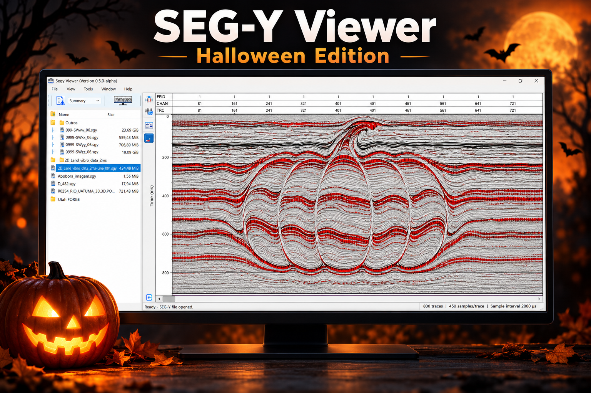

# 🎃 Halloween SEG-Y

A pumpkin to display in your seismic software!

This repository provides a SEG-Y file created from a Halloween image resembling a seismic section. The image was converted into an amplitude matrix so that the pumpkin can be displayed in software that reads SEG-Y files.



## Download

**[🎃 Download the Halloween SEG-Y file](halloween_pumpkin_synthetic_post_stack.sgy?raw=true)**

## Meet SEG-Y Viewer

**SEG-Y Viewer is a desktop application currently under development by Emerson Alves da Silva, a geophysicist with experience in land seismic acquisition and quality control.**

Built with Python and PySide6, the project focuses on detailed seismic visualization, smooth trace navigation, and SEG-Y header inspection. This Halloween example brings a playful twist to its Wiggle / Variable Area display.

The application is currently in **alpha development**, with additional visualization and analysis features being developed.

**Follow Emerson Alves da Silva on LinkedIn for development updates and demonstrations.**

## File specifications

| Parameter | Value |
| --- | --- |
| Filename | `halloween_pumpkin_synthetic_post_stack.sgy` |
| Format | SEG-Y revision 1 |
| Number of traces | 800 |
| Samples per trace | 450 |
| Sample interval | 2 ms (2,000 µs) |
| Time from first to last sample | 0 to 898 ms |
| Sample format | IEEE float32 — format code 5 |
| Byte order | Big-endian |
| Amplitude range | Within −1 to +1 |
| Approximate file size | 1.64 MB |

## How the file was created

Each column of the original image was converted into a trace, and each pixel along the vertical axis corresponds to one sample. The top row of the image corresponds to the first sample of each trace.

The colors were converted to luminance and mapped to amplitudes using:

```text
L = 0.2126 × R + 0.7152 × G + 0.0722 × B
Amplitude = 1 − 2 × L
```

R, G, and B are normalized to the range 0 to 1. Darker regions produce more positive amplitudes, while lighter regions produce more negative amplitudes.

This conversion preserves the image's shape and grayscale details. The original colors are not stored in the SEG-Y file; the displayed colors depend on the viewer's color palette.

## How to display the file

To see the entire pumpkin:

1. Open the file in a SEG-Y viewer.
2. Display all **800 traces** and the full time window, approximately **0 to 900 ms**.
3. Disable AGC and individual trace normalization to preserve the image's amplitude relationships.
4. Set the plot area to an aspect ratio of approximately **16:9** to preserve the original image proportions.

### Variable Density

This is the recommended mode for reproducing the grayscale image. Set the color scale to **−1 to +1**, with **white at −1** and **black at +1**. Adjust gain and automatic scaling as needed to preserve this mapping.

You can also experiment with other color palettes.

### Wiggle / Variable Area

The file can also be displayed using **Wiggle**, **Variable Area**, or a combination of both. It has been displayed in Wiggle/VA mode in SEG-Y Viewer, with the pumpkin's outline, lobes, and stem remaining recognizable.

In these modes, the appearance depends on gain, trace excursion, and fill settings.

## About the filename and data

The name `halloween_pumpkin_synthetic_post_stack.sgy` refers to the Halloween theme and its resemblance to a post-stack seismic section.

This file is a **synthetic graphical representation** created by converting an image. It does not originate from seismic acquisition, physical subsurface modeling, or seismic stacking. The time axis and amplitudes were assigned to represent the image.

It is intended for demonstrations and experiments with seismic visualization.

Happy Halloween and enjoy the visualization! 🎃